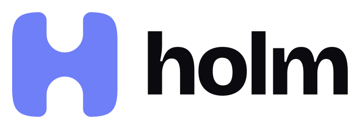
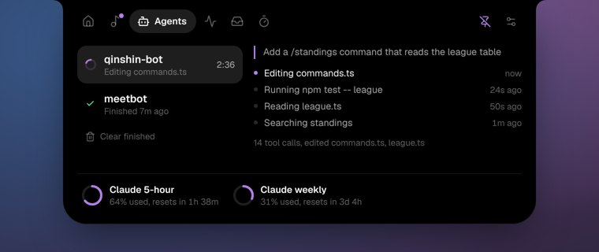
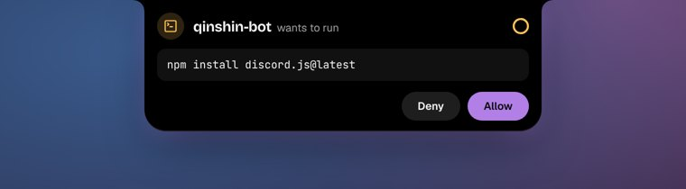
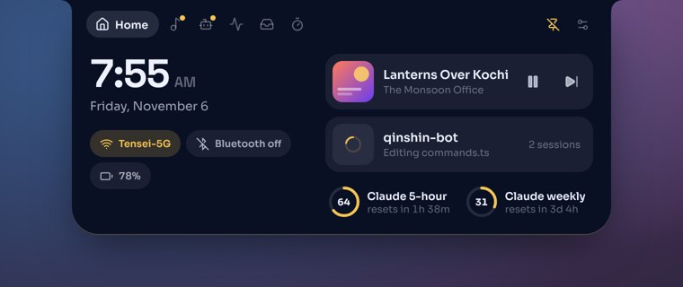
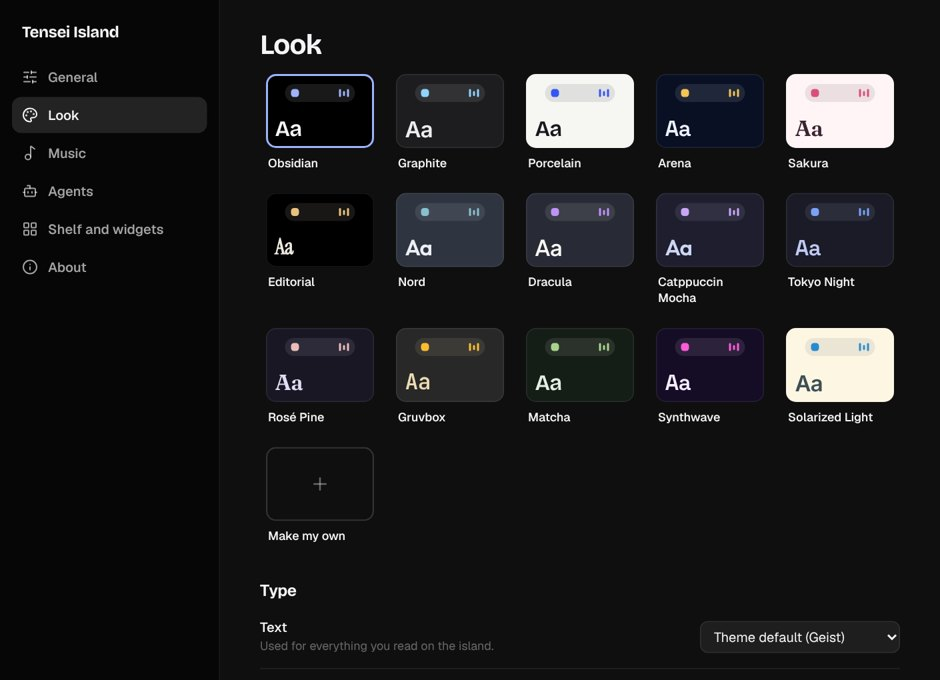

<h1 align="center">
  <picture>
    <source media="(prefers-color-scheme: dark)" srcset="docs/brand/holm-logo-dark.svg">
    
  </picture>
</h1>

<p align="center"><b>A Dynamic Island for Windows that knows when to get out of the way.</b></p>

<p align="center">
  <a href="https://github.com/IndraTensei/holm/releases/latest"></a>
  <a href="https://github.com/IndraTensei/holm/releases"></a>
  <a href="https://github.com/IndraTensei/holm/actions/workflows/build.yml"></a>
  <a href="LICENSE"></a>
  
</p>

<p align="center">
  <a href="https://holm.indratensei.me"><b>Website</b></a> ·
  <a href="https://github.com/IndraTensei/holm/releases/latest">Download</a> ·
  <a href="CHANGELOG.md">Changelog</a> ·
  <a href="CONTRIBUTING.md">Contributing</a> ·
  <a href="https://github.com/IndraTensei/holm/discussions">Discussions</a>
</p>

<br>

<p align="center">
  
</p>

<br>

The top of your screen is mostly empty. Holm puts a small island there that quietly keeps you in the loop: the
song that's playing, what Claude Code is doing in your terminals, how much of your plan you've used, a focus
timer, the weather. Hover over it and it opens. Move away and it tucks itself back in.

It's built to be the opposite of a heavy desktop widget. Holm uses the WebView2 runtime that Windows already
has, so the installer is about 2 MB, it sits at a fraction of a percent of one processor core when idle, and
nothing on screen moves while it's hidden.

<p align="center">
  <a href="https://github.com/IndraTensei/holm/releases/latest"><b>Download for Windows 10 and 11</b></a>
  <br>
  <sub>Free and open source · No administrator rights needed · macOS and Linux versions are in the works</sub>
</p>

## A quick tour

### Music that feels at home

Play something in Spotify, Apple Music, TIDAL, Deezer, VLC, YouTube in a browser, or anything else that shows up
in the Windows media card, and Holm picks it up with no setup. You get the cover, synced lyrics you can tap to
jump to, seek, shuffle and repeat, and a volume slider for that app alone, not your whole PC. The island even
takes its accent colour from the album art. While a song plays, the resting island can show just the cover, the
title, or the line being sung.

Using Pear Desktop? Connect it and you also get likes, dislikes and exact progress.

<p align="center">
  
</p>

### Your coding agents, at a glance

Connect Claude Code once, and every session shows up live: what it's reading, editing or running, and for how
long. When it asks for permission, the island opens with **Allow** and **Deny** so you can answer without
hunting for the right terminal. When it finishes, you hear a soft chime and see a one-line summary. Your 5-hour
and weekly limits sit in a small ring.

Holm also spots the other AI coding tools on your PC (Codex, OpenCode, Gemini CLI, Copilot CLI, Cline, Cursor
Agent, Amp and more) and shows which are running and what each one used today.

<table align="center">
  <tr>
    <td></td>
    <td></td>
  </tr>
  <tr>
    <td align="center"><sub>Every session, live</sub></td>
    <td align="center"><sub>Answer permission requests from the island</sub></td>
  </tr>
</table>

### A home for the small things

The home page puts the clock, the weather, Wi-Fi and Bluetooth toggles and your battery next to what's playing
and what your agents are up to. Drop files on the island to keep them on a shelf, scroll back through your
clipboard, jot a quick note, or start a focus timer that counts down right in the island.

<p align="center">
  
</p>

### Ready when you game

Start a game and the island plays a short intro with the game's own logo, then steps aside completely while you
play. Press a shortcut if you want it back. When you're done, it shows you what your agents finished while you
were away.

### Polite by design

Holm tries hard never to be in the way. Over a maximized app, the full island stays put until your pointer comes
right up to it, on its way to a browser's tabs say, and then it slips down to a thin line so your click lands
where you meant it. It comes back the moment you move off. It rests as a line when nothing is happening, never
opens while you're dragging something, never steals focus, and respects Windows' Do not disturb.

### Make it yours

Choose a Notch, Pill or Line shape, one of 15 themes or your own, 13 typefaces, and springy, smooth or minimal
motion.

<p align="center">
  
</p>

More screens live in [docs/screenshots](docs/screenshots).

## Getting started

1. Download **`Holm_<version>_x64-setup.exe`** from the [latest release](https://github.com/IndraTensei/holm/releases/latest)
   and run it. It asks where to install, whether Holm should start when you sign in, and whether you'd like
   Start menu and desktop shortcuts.
2. Holm isn't code-signed yet, so Windows SmartScreen may say it "protected your PC". Choose **More info →
   Run anyway**.
3. Look at the top of your screen. That's it.

Prefer not to install anything? **`Holm-<version>-portable-x64.exe`** is the whole app in one file. Put it
anywhere and run it.

<details>
<summary><b>Connect Claude Code</b></summary>
<br>

Open Settings → Agents → **Connect Claude Code**. Holm adds its hooks to `~/.claude/settings.json` (keeping a
backup) so Claude Code can report to the island on `127.0.0.1:47821`. Restart any Claude Code sessions that were
already running.
</details>

<details>
<summary><b>Connect Pear Desktop</b></summary>
<br>

In Pear, turn on Plugins → API Server. Then in Holm, open Settings → Music → **Connect Pear** and choose Allow in
Pear's dialog.
</details>

<details>
<summary><b>Install for many PCs at once</b></summary>
<br>

`Holm_<version>_x64-setup.exe /S` installs silently. Add `/AUTOSTART` to start Holm when users sign in, or `/NS`
for no shortcuts.
</details>

## Everyday use

| To | Do this |
| --- | --- |
| Open the island | Hover over it, or press **Ctrl+Alt+Space** |
| Jump to the other thing going on | Click the small bubble beside the island |
| Open it over a maximized app | Push the pointer to the very top edge |
| Hide it for a while | **Ctrl+Alt+H**, or right-click the tray icon |
| Change anything | Right-click the tray icon → Settings |
| Update | Settings → About → **Update** (Holm also tells you when there's a new version) |
| Uninstall | Settings → About → **Uninstall Holm** |

Both shortcuts can be changed in Settings → General. Your settings live in `%APPDATA%\in.tenseitech.holm`.

## Where it runs

| System | Status |
| --- | --- |
| Windows 11, 64-bit | Supported and tested |
| Windows 10 version 1809 or later, 64-bit | Supported |
| Windows on ARM | Not built yet (the x64 build may run under emulation, untested) |
| macOS | In development, see [#10](https://github.com/IndraTensei/holm/issues/10) |
| Linux | In development, see [#11](https://github.com/IndraTensei/holm/issues/11) |

Most of Holm, from the island and its pages to settings, themes, lyrics and the Claude Code connection, is the
same everywhere. The parts that talk to the operating system (the always-on-top window, now playing, volume,
Wi-Fi and Bluetooth, game detection, start at login and the installer) need their own version on each system.
Want Holm on your Mac or Linux desktop sooner? The tracking issues list every piece, so pick one and say so there.

## Light on your PC

Measured on Windows 11 with an Intel Core i7-11700 at 1920×1080, default settings. The figures include Holm's
WebView2 processes; CPU is a share of one core.

| What's happening | CPU | Memory |
| --- | --- | --- |
| Resting at the top of the screen | 0.3% | 116 MB |
| A song playing, lyrics in the island, an agent working | 2.5% | 112 MB |
| Open, with an agent working | 8% | 143 MB |

<details>
<summary><b>How it stays that light</b></summary>
<br>

- **No 60 fps loops.** The equalizer and spinners step together on a shared 8 frames a second, each on its own
  small layer. Nothing moves at all while the island is hidden or a game or full-screen app is in front.
- **Clocks that only tick when needed.** Once a second normally, four times a second only while the music page is
  open. Lyrics in the resting island move on with one timer per line, and the island keeps one width for the
  whole song instead of resizing on every line.
- **A cheap pointer check.** Holm asks Windows where the pointer is 25 times a second (60 near the island), with
  no mouse hook in your input, and the island only hears about changes.
- **A lean WebView2.** Drawing is in software by default, with no spare page process, no background downloads,
  and one page process for both windows. Settings → General → Graphics → Hardware uses about 100 MB more memory
  and a little less processor while the island is open.
- **About Task Manager.** Holm's WebView2 processes are listed inside the Holm group on the Processes tab. On the
  Details tab they appear as `msedgewebview2.exe`, Microsoft's own runtime, with `holm.exe` in their command
  line. Task Manager's working set reads higher (about 400 MB) because it counts shared memory once per process;
  the figures above are what Holm actually holds. Quitting Holm closes them all.
- **Small footprint.** About a 2 MB installer and 5 MB on disk, plus the WebView2 runtime Windows already has.
</details>

**You'll need** Windows 10 version 1809 or later, or Windows 11, 64-bit; the WebView2 runtime (built into
Windows 11, and the installer fetches it if it's missing); about 150 MB of free memory; and any 64-bit dual-core
processor. No particular graphics card is needed.

## Privacy

- Your music, system readings, clipboard and Claude Code activity never leave your PC.
- Plan usage asks Anthropic and OpenAI using the sign-ins already on your PC, and only if you turn it on.
- Lyrics (LRCLIB) and weather (Open-Meteo) are fetched only if you turn them on, sending just the song or the
  place.
- Once a day Holm asks GitHub whether there's a new version, sending nothing about you. You can turn that off in
  Settings → About.

## Contributing

Holm is open for development, and help of every size is welcome.

- **Found a bug?** [Open a bug report](https://github.com/IndraTensei/holm/issues/new?template=1_bug_report.yml).
  A game Holm doesn't recognise has [its own form](https://github.com/IndraTensei/holm/issues/new?template=3_game_support.yml),
  and so does [high CPU or memory](https://github.com/IndraTensei/holm/issues/new?template=4_performance.yml).
- **Have an idea?** [Request a feature](https://github.com/IndraTensei/holm/issues/new?template=2_feature_request.yml),
  or talk it through first in [Ideas](https://github.com/IndraTensei/holm/discussions/categories/ideas).
- **Have a question?** Ask in [Q&A](https://github.com/IndraTensei/holm/discussions/categories/q-a).
- **Want to write code?** Start with [CONTRIBUTING.md](CONTRIBUTING.md), then look for a
  [good first issue](https://github.com/IndraTensei/holm/labels/good%20first%20issue) or
  [help wanted](https://github.com/IndraTensei/holm/labels/help%20wanted), or help bring Holm to
  [macOS](https://github.com/IndraTensei/holm/issues/10) and [Linux](https://github.com/IndraTensei/holm/issues/11).
- **No Windows PC?** You can still work on the island's look and pages. `npm run dev` runs it in any browser
  with sample data.

Please follow the [Code of Conduct](CODE_OF_CONDUCT.md), and report security problems privately as described in
[SECURITY.md](SECURITY.md).

## Build from source

**You'll need**

- Windows 10 or 11
- [Node.js](https://nodejs.org) 22 or later
- [Rust](https://rustup.rs) stable, with the MSVC toolchain
- The [Visual Studio C++ Build Tools](https://visualstudio.microsoft.com/visual-cpp-build-tools/) ("Desktop development with C++")

**Steps**

1. Get the code:

   ```sh
   git clone https://github.com/IndraTensei/holm.git
   cd holm
   ```

2. Install the frontend packages:

   ```sh
   npm ci
   ```

3. Run Holm in development, with hot reload for the UI:

   ```sh
   npx tauri dev
   ```

4. Build the installer and the app:

   ```sh
   npx tauri build
   ```

   The installer lands in `src-tauri/target/release/bundle/nsis`, and the app itself is
   `src-tauri/target/release/holm.exe`.

Only want to work on the look? `npm run dev` runs the island in any browser with sample data, no Rust needed.

**How releases are made**

Every push and pull request is type-checked, linted, tested and built on Windows by
[`.github/workflows/build.yml`](.github/workflows/build.yml). Tagging `vX.Y.Z` on `main` publishes a release with
the installer, the portable exe, and notes from `docs/releases/vX.Y.Z.md`.

**Learn more**

- [CONTRIBUTING.md](CONTRIBUTING.md): setup details, checks to run, and the house rules
- [docs/ARCHITECTURE.md](docs/ARCHITECTURE.md): how the pieces fit together
- [STATUS.md](STATUS.md): what's done and what's next

## License

MIT, see [LICENSE](LICENSE). Third-party code, logos and typefaces keep their own licenses, listed in
[NOTICE](NOTICE).
