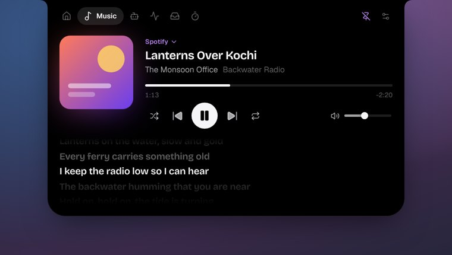

# Tensei Island

A Dynamic Island for Windows 10 and 11 that stays small. It sits at the top of the screen and shows what is
going on: the song that is playing (Spotify, Pear, browsers, any player in the Windows media card), what Claude
Code is doing in your terminals, your Claude plan usage, a focus timer, and quick system readings. Hover to open
it; it closes when you move away.

Built with Tauri and Svelte on the WebView2 runtime that Windows already has: a few MB to install, no bundled
browser, nothing running in the background that does not need to.



## What it does

- **Music, no setup**: Spotify, Apple Music, TIDAL, Deezer, Amazon Music, VLC, browsers (YouTube, SoundCloud,
  Spotify web) and anything else in the Windows media card. Cover, title, synced lyrics, seek, shuffle, repeat,
  and the playing app's own volume (not the whole PC's). The accent colour follows the album art.
- **Pear Desktop**: also likes, dislikes and exact progress through Pear's API Server plugin.
- **Claude Code**: live activity per session (reading, editing, running), Allow or Deny permission requests from
  the island, a chime and a summary when it finishes, and your 5-hour and weekly limits as a ring.
- **Harnesses**: finds the AI coding agents on your PC (Claude Code, Codex, OpenCode, Antigravity, Gemini CLI,
  Copilot CLI, Cline, Cursor Agent, Amp and more), shows which are running and what each used today, read
  from the files each one already keeps, each with its own logo.
- **Games**: an intro when a game starts, out of the way while you play, a hotkey to bring it back, and the
  agent news you missed when you are done.
- **Calm by default**: rests as a thin line when idle and over browser tabs, never opens mid-drag, respects
  Windows Do not disturb, never takes focus.
- **Shelf**: drop files on the island to keep them handy, clipboard history, a quick note.
- **Focus**: a timer that counts down in the island while you work.
- **Home**: clock, weather, Wi-Fi and Bluetooth toggles, battery.
- **Looks**: Notch, Pill or Line; 15 themes plus your own; 13 bundled typefaces; springy, smooth or minimal motion.

More screens in [docs/screenshots](docs/screenshots) (browser preview with sample data).

## Performance

Measured on the optimized build: Windows 11 Pro (build 26200), Intel Core i7-11700 (8 cores, 16 threads),
GeForce GTX 1660 Super, 16 GB, 1920×1080 at 100%, WebView2 156, default settings (Graphics: Software).
Figures are the island plus its WebView2 processes; CPU is a share of one core.

| State | CPU, one core | Memory (private) |
| --- | --- | --- |
| At rest | 0.3% | 116 MB |
| Open, with an agent working (spinner moving) | 8% | 143 MB |
| Open, with the settings window open too | | 156 MB |

- With Graphics → Hardware it holds about 100 MB more (225 to 260 MB) and uses a little less processor while
  open (5% in the same state).
- Task Manager's working set reads higher (about 400 MB) because memory shared between the WebView2 processes
  is counted once per process; private memory above is what the island actually holds.
- Loops (equalizer, spinner) step together at 8 frames a second instead of 60 and sit on their own small
  layers; clocks tick once a second unless lyrics need more; nothing moves while the island is hidden or a game
  or full-screen app is in front.
- WebView2 runs lean: no spare page process, no background downloads, one page process for both windows.
- Network: nothing unless turned on. Plan usage is read from the copy Claude Code and Codex keep on the PC,
  and their usage services are asked at most every 5 minutes, only when that copy is old.
- Install size: about 2 MB installer, 5 MB on disk, plus the WebView2 runtime that Windows already has.

## Minimum requirements

- Windows 10 version 1809 or later, or Windows 11, 64-bit (x64).
- Microsoft Edge WebView2 Runtime: built into Windows 11 and present on most Windows 10 PCs; the installer
  fetches it if missing.
- About 150 MB of free memory for the island (4 GB of RAM works), and any 64-bit dual-core processor.
- No particular graphics card: drawing is in software by default (Hardware in Settings needs DirectX 11).
- Internet only for the optional parts: lyrics, weather, plan usage.

## Install

Download the setup .exe (or the portable zip) from the latest GitHub release or the latest Actions run, and run
it. Settings and data live in `%APPDATA%\in.tenseitech.island`.

### Connect Pear Desktop
In Pear: Plugins → API Server → on. In the island: Settings → Music → Connect Pear, then Allow in Pear's dialog.

### Connect Claude Code
Settings → Agents → Connect Claude Code. This adds HTTP hooks to `~/.claude/settings.json` (a backup is kept)
pointing at `127.0.0.1:47821`. Restart running Claude Code sessions.

## Shortcut
Ctrl+Alt+Space opens and closes the island (change it in Settings → General).

## Build

```sh
npm ci
npx tauri dev     # run
npx tauri build   # installer
```

Pushing to GitHub runs `.github/workflows/build.yml` on a Windows runner and uploads the installer and a
portable zip; tagging `v*` publishes a release. See CLAUDE.md for development notes and STATUS.md for what is done.

## Privacy

Media, system readings, clipboard and Claude Code activity stay on your PC. Plan usage asks Anthropic and OpenAI
with the sign-ins already on the PC, only when turned on. Lyrics (LRCLIB) and weather (Open-Meteo) are fetched only
when turned on, sending just the track or place.
